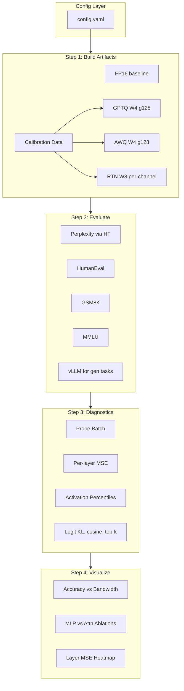

# Quantization Comparative Study Implementation Plan

## Architecture Overview




---

## Project Structure

```
227_Project/
├── config/
│   └── default.yaml          # Single config driving everything
├── src/
│   ├── __init__.py
│   ├── quantize/
│   │   ├── module_utils.py   # Programmatic allowlist/denylist from Linear enumeration
│   │   ├── gptq.py           # AutoGPTQ (full ablations)
│   │   ├── awq.py            # AutoAWQ (full_quant only if tooling blocks selective)
│   │   └── rtn.py            # RTN/bitsandbytes INT8 (full ablations)
│   ├── eval/
│   │   ├── perplexity.py      # HuggingFace teacher-forcing
│   │   ├── humaneval.py
│   │   ├── gsm8k.py
│   │   └── mmlu.py
│   ├── utils/
│   │   └── checkpoint_size.py # Compute bytes_per_param_actual from safetensors
│   ├── diagnostics/
│   │   └── layer_probe.py    # Activation stats + output MSE
│   └── viz/
│       └── plots.py
├── scripts/
│   ├── 01_build_artifacts.py
│   ├── 02_run_eval.py
│   ├── 03_layer_diagnostics.py
│   └── 04_generate_plots.py
├── artifacts/                 # Output: quantized checkpoints
│   ├── fp16/
│   ├── gptq_w4_g128/
│   │   ├── full_quant/
│   │   ├── attn_only_quant/
│   │   └── mlp_only_quant/
│   ├── awq_w4_g128/
│   │   └── (same variants)
│   └── rtn_w8_perchannel/
│       └── (same variants)
├── results/
│   ├── eval.jsonl
│   ├── layer_stats.parquet
│   ├── logit_diagnostics.json
│   └── plots/
├── calibration_data/          # Cached calibration samples
├── requirements.txt
└── README.md
```

---

## Phase 1: Configuration and Calibration

### 1.1 Config Schema ([config/default.yaml](config/default.yaml))

```yaml
base_model: "Qwen/Qwen2-7B"
calibration:
  dataset: "wikitext"           # or "c4" for larger; wikitext-2-raw-v1
  num_samples: 512              # 512–2048 typical
  max_length: 2048
  seed: 42
quant_configs:
  - method: gptq
    bits: 4
    group_size: 128
  - method: awq
    bits: 4
    group_size: 128
  - method: rtn
    bits: 8
    per_channel: true
ablation_variants:
  - full_quant
  - attn_only_quant
  - mlp_only_quant
eval_tasks: [perplexity, humaneval, gsm8k, mmlu]
accuracy_weights: {humaneval: 0.4, gsm8k: 0.3, mmlu: 0.3}
```

### 1.2 Calibration Data

- Use `datasets` library: `wikitext-2-raw-v1` or `c4` (en) subset
- Tokenize with model tokenizer; produce fixed list of `input_ids` tensors
- Cache to `calibration_data/calibration_{num_samples}.pt` for reproducibility
- Same calibration set used for GPTQ, AWQ, and RTN

---

## Phase 2: Quantization Implementation

### 2.1 Programmatic Allowlist/Denylist ([src/quantize/module_utils.py](src/quantize/module_utils.py))

- **Do not hardcode** module names. Selective quantization support differs across GPTQ vs AWQ.
- Enumerate all `nn.Linear` layers via `model.named_modules()` and classify by pattern:
  - `attn`: layers matching `self_attn.(q|k|v|o)_proj`
  - `mlp`: layers matching `mlp.(gate|up|down)_proj`
  - `other`: embeddings, lm_head, etc.
- Build allowlist/denylist per variant:
  - `full_quant`: all Linear layers
  - `attn_only_quant`: only attn projections (denylist = mlp + other)
  - `mlp_only_quant`: only mlp projections (denylist = attn + other)

### 2.2 GPTQ 4-bit ([src/quantize/gptq.py](src/quantize/gptq.py))

- **Library**: `auto-gptq`
- **Config**: `bits=4`, `group_size=128`, `desc_act=False`
- Use programmatic `modules_to_not_convert` (denylist) from `module_utils`
- **Ablations**: Full support for all three variants (full, attn_only, mlp_only)
- Export: `model.save_quantized(artifacts/gptq_w4_g128/<variant>/, use_safetensors=True)`
- vLLM loads via `--quantization gptq`

### 2.3 AWQ 4-bit ([src/quantize/awq.py](src/quantize/awq.py))

- **Library**: `autoawq`
- **Config**: `q_group_size=128`, `w_bit=4`, `zero_point=True`, `version="GEMM"`
- **Ablation support is limited**: AutoAWQ may not cleanly support fine-grained selective quantization.
- **Fallback**: If tooling blocks attn_only/mlp_only, run only `full_quant` for AWQ and document this limitation.
- Export: `model.save_quantized(artifacts/awq_w4_g128/<variant>/)`
- vLLM loads via `--quantization awq`

### 2.4 RTN 8-bit Per-Channel ([src/quantize/rtn.py](src/quantize/rtn.py))

- **Symmetric quantization**: `scale = max(abs(W)) / 127`; clamp to **[-127, 127]** (not -128) to avoid asymmetric use of range.
- **Kernel realism**: A naïve dequant loop defeats the "mobile realism" objective.
- **Two paths** (choose based on feasibility):
  - **Path A (preferred)**: Use **bitsandbytes** as the practical INT8 baseline—it provides real INT8 GEMM support and is vLLM-compatible. Document that this is the "practical RTN-like" baseline.
  - **Path B (analytical)**: If implementing custom RTN: either integrate with proper INT8 GEMM (e.g., via llm-compressor W8A16 or vLLM plugin with real kernels), or **explicitly state in the paper/report that RTN results are analytical (no optimized kernels)** and not directly comparable for latency/bandwidth.
- **Ablations**: Full support for all three variants (full, attn_only, mlp_only)

---

## Phase 3: Evaluation Pipeline

### 3.1 Perplexity (HuggingFace, Not vLLM)

- **vLLM is not ideal for perplexity**—it is optimized for generation, not teacher-forcing loss.
- Use **HuggingFace** `transformers` forward pass with `labels=input_ids` for perplexity:
  - Load model (FP16 or quantized) via `AutoModelForCausalLM.from_pretrained`
  - Run on WikiText-2 validation split with teacher-forcing
  - Compute `ppl = exp(mean(cross_entropy_loss))`
- Same approach for all artifacts (FP16, GPTQ, AWQ, RTN/bitsandbytes).

### 3.2 Generation-Based Tasks (vLLM)

- **Use vLLM** for: HumanEval, GSM8K, MMLU, and throughput benchmarking.
- Load each artifact: `LLM(model=artifact_path, quantization=...)`
- **HumanEval**: pass@1
- **GSM8K**: accuracy
- **MMLU**: 5-shot accuracy

### 3.3 Ablations on Real Tasks

- **Do not restrict ablations to probe diagnostics only.**
- Evaluate at least one real downstream task (GSM8K or MMLU) for:
  - `full_quant`
  - `attn_only_quant`
  - `mlp_only_quant`
- This yields defensible claims about which module family (MLP vs attention) is truly more sensitive to quantization.

### 3.4 Output Schema ([results/eval.jsonl](results/eval.jsonl))

```json
{"method":"gptq","variant":"full_quant","ppl":12.3,"humaneval":0.45,"gsm8k":0.32,"mmlu":0.58,"score":0.45,"bytes_per_param_actual":0.52,"tok_s":85,"ms_per_token":11.8,"peak_vram_gb":8.2}
```

- `score = 0.4*humaneval + 0.3*gsm8k + 0.3*mmlu` (normalized to [0,1] if needed)
- `bytes_per_param_actual`: computed from checkpoint files (see 3.6)
- `tok_s`, `ms_per_token`, `peak_vram_gb`: real deployment metrics (see 3.5)

### 3.5 Real Deployment Metrics

- **Bandwidth alone is not enough.** Also measure:
  - **Tokens/sec** (`tok_s`): throughput under fixed batch size
  - **ms/token** (`ms_per_token`): latency per token
  - **Peak memory (VRAM)** (`peak_vram_gb`): via `torch.cuda.max_memory_allocated()` or vLLM profiler
- These strengthen the "sweet spot" claim in the trade-off plot.

### 3.6 Bandwidth Proxy: Actual Stored Sizes

- **Do not use fixed 0.5 / 1.0 / 2.0 bytes-per-param.**
- Compute **actual stored tensor sizes** from checkpoint files:
  - Iterate over safetensors/tensors in each artifact
  - Sum `tensor.numel() * dtype_bytes` for weights + scales/zeros
  - Report `bytes_per_param_actual = total_bytes / num_params`
- This makes the accuracy-vs-bandwidth plot defensible.

---

## Phase 4: Layer Diagnostics

### 4.1 Probe Batch ([src/diagnostics/layer_probe.py](src/diagnostics/layer_probe.py))

- Fixed probe batch (e.g., 32 sequences × 256 tokens) from calibration
- Run through **FP16** and **quantized** models with forward hooks
- For each transformer block i:
  - **Activation stats** (input to each Linear): p50, p90, p99, p99.9, max (per channel or per-tensor)
  - **Output MSE**: `MSE = ||y_fp16 - y_quant||^2 / N` per layer
- Aggregate by module family: `attn` (q/k/v/o_proj), `mlp` (gate/up/down_proj)

### 4.2 Strengthened Diagnostics (Beyond MSE)

- **Layer MSE alone is not sufficient** for reasoning degradation.
- Add **logit-level metrics** (FP16 vs quant, over probe batch):
  - **Logit KL divergence**: `KL(P_fp16 || P_quant)` over vocabulary
  - **Logit cosine similarity**: `cos(logits_fp16, logits_quant)` per position
  - **Top-k agreement**: fraction of positions where argmax/top-k predictions match
- These better reflect downstream reasoning degradation than per-layer MSE.

### 4.3 Output ([results/layer_stats.parquet](results/layer_stats.parquet))

Columns: `method`, `variant`, `layer_idx`, `module_family`, `module_name`, `mse`, `p50`, `p90`, `p99`, `p99_9`, `max`

Additional logit-level output ([results/logit_diagnostics.json](results/logit_diagnostics.json)): `method`, `variant`, `kl_div`, `cosine_sim`, `top1_agreement`, `top5_agreement`

---

## Phase 5: Visualization

### 5.1 Plots ([src/viz/plots.py](src/viz/plots.py))

1. **Scatter: Accuracy vs Bandwidth**
  - X: `bytes_per_param_actual` (from checkpoint files, not fixed estimates)
  - Y: `score`
  - Points: each method × variant
  - Identify "sweet spot" (knee)
2. **Scatter: Accuracy vs Deployment Metrics**
  - Optional: accuracy vs `tok_s`, vs `ms_per_token`, vs `peak_vram_gb` to show trade-offs
3. **Bar: MLP vs Attn Sensitivity**
  - Compare `full_quant` vs `attn_only_quant` vs `mlp_only_quant` on **real task** (GSM8K or MMLU)
  - For each method: `score(full) - score(attn_only)` and `score(full) - score(mlp_only)`
  - Show which module family is truly more sensitive
4. **Heatmap: Per-Layer MSE**
  - Rows: layer index
  - Cols: module family (or layer)
  - Color: MSE
  - Separate heatmaps per method (or one combined)

---

## Dependencies ([requirements.txt](requirements.txt))

```
torch>=2.0
transformers>=4.36
accelerate
auto-gptq
autoawq
bitsandbytes          # Optional: practical INT8 baseline for RTN
vllm
datasets
evaluate
pandas
pyarrow
matplotlib
seaborn
pyyaml
safetensors          # For checkpoint size computation
```

---

## Execution Order


| Step | Script                    | Purpose                                                             |
| ---- | ------------------------- | ------------------------------------------------------------------- |
| 0    | Config                    | Edit `config/default.yaml` for model/paths                          |
| 1    | `01_build_artifacts.py`   | Quantize + export all variants                                      |
| 2    | `02_run_eval.py`          | Perplexity (HF) + HumanEval/GSM8K/MMLU (vLLM) + tok_s, ms/tok, VRAM |
| 3    | `03_layer_diagnostics.py` | Probe batch: MSE, activation stats, logit KL/cosine/top-k           |
| 4    | `04_generate_plots.py`    | Scatter (accuracy vs bytes), bar (MLP vs attn), heatmap (layer MSE) |


---

## Critical Implementation Notes

1. **Kernel realism**: Generation evals run through vLLM—no "fake quant" or dequant loops. GPTQ and AWQ use native packed kernels; RTN uses bitsandbytes or proper INT8 GEMM (or is explicitly labeled analytical).
2. **Perplexity**: Use HuggingFace forward pass for perplexity; vLLM is not suitable for teacher-forcing loss.
3. **Programmatic allowlists**: Enumerate all `nn.Linear` layers via `model.named_modules()`; do not hardcode module names. Use `module_utils` to build allowlist/denylist per variant.
4. **AWQ ablations**: If AutoAWQ tooling blocks selective quantization, run only `full_quant` for AWQ and document the limitation. GPTQ and RTN/bitsandbytes support full ablations.
5. **Calibration consistency**: Same tokenized calibration data for all methods; same seed for reproducibility.
6. **Bandwidth**: Compute actual stored sizes from checkpoint files; do not use fixed bytes-per-param estimates.
7. **Ablations on real tasks**: Run GSM8K or MMLU for ablations (full_quant, attn_only, mlp_only) to claim which module family is more sensitive.

---

## Open Questions Resolved

- **Model**: Qwen2-7B
- **Hardware**: Cloud (A100/H100) — full support for GPTQ, AWQ, INT8
- **Ablation approach**: Option A (export-time selective quant) — recommended

